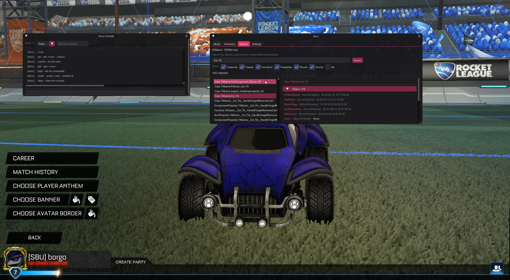

# Kuru

A mod loader and C++ modding SDK for (offline) Rocket League.

Kuru injects into Rocket League, hooks its UnrealScript and native functions, and gives mods a C++ API
to read and edit game state, react to events, draw overlays, and register console commands. It resolves
many engine bindings at runtime. Game updates can still require new patterns, layout checks, and a
regenerated SDK.



## Features

- Hook reflected functions reached through the supported dispatch layers, and inspect, edit, or block calls.
- A reflected SDK generated from the game - typed access to Rocket League's classes.
- In-game overlay (F2) and console (F3), with built-in object and function browsers.
- Console commands, persistent settings, and a typed event system for mods.
- Runtime resolution of engine bindings, with version-specific layouts and a fallback for interpreter globals.

## Install

1. Download `Kuru.exe` from [releases](https://github.com/borgox/Kuru/releases).
2. Run it, launch Rocket League, and wait at the main menu.
3. Inject the loader, then press F2 for the menu or F3 for the console.

The injector includes the loader and SDK generator DLLs and normally extracts them to
`%APPDATA%\Kuru\bin`. Use its mod installer, or copy mod DLLs into the `mods` folder next to the
configured loader (normally `%APPDATA%\Kuru\bin\mods`). Mods are discovered when the loader starts,
install them before injection. See [installation and updating](docs/installing.md).

> Kuru is for offline and casual play. Don't use it where it could affect other players or your account.

## Writing a mod

A mod is a small C++ DLL:

```cpp
#include <Kuru/Kuru.hpp>

class MyMod final : public Kuru::IMod {
public:
    bool OnLoad() override {
        Kuru::Hooks::Post("Function TAGame.Ball_TA.OnHitGoal", [](Kuru::HookContext&) {
            Kuru::Info("goal scored");
        });
        return true;
    }
};

KURU_EXPORT_MOD(MyMod, "MyMod", "your name", "0.1.0")
```

Download `Kuru-mod-template-1.0.2.zip` from [releases](https://github.com/borgox/Kuru/releases),
or use **Developer → Generate SDK** at the main menu. The generator writes a self-contained `mod-template`
folder with the generated headers, SDK runtime, and matching ImGui sources embedded in its DLL.
It needs no Kuru source checkout or external SDK paths. Start with the
[environment setup guide](docs/modding/getting-started/environment-setup.md), the repository's
`templates/mod-template` is the packaging source, not the generated bundle.

## Documentation

- [Documentation index](docs/README.md)
- [Getting started](docs/modding/getting-started/what-is-a-mod.md) - write your first mod
- [Guides](docs/README.md) - hooks, the SDK, GUI, events, and more
- [Concepts](docs/README.md) - how Rocket League and Kuru work under the hood
- [API reference](docs/README.md)
- [Building from source](docs/building.md)

## Built with

- [MinHook](https://github.com/TsudaKageyu/minhook) - function hooking
- [Dear ImGui](https://github.com/ocornut/imgui) - the overlay

Inspired by [BakkesMod](https://bakkesmod.com/) and Toga.

## License

MIT - see [LICENSE](LICENSE).
